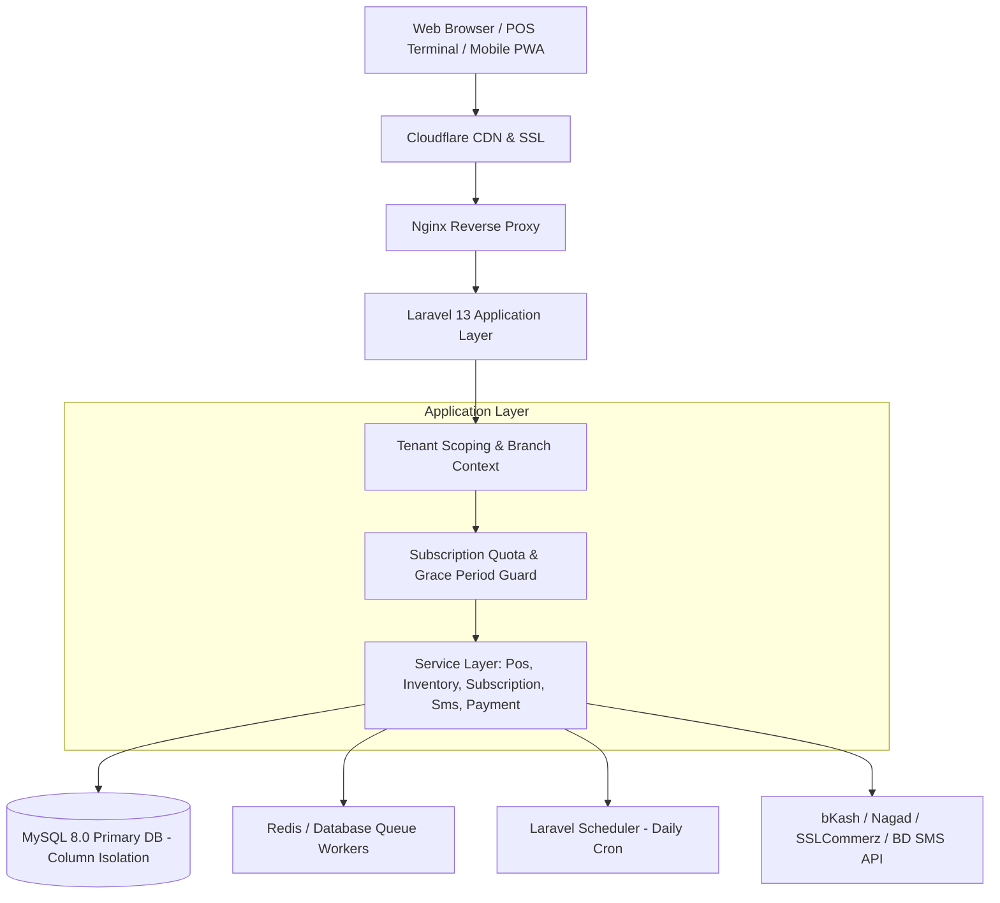

# System & Software Architecture: SmartPOS SaaS

## 1. High-Level System Architecture
SmartPOS SaaS is structured as a cloud-native, multi-tenant Business Operating System engineered for Bangladeshi SMEs.

---

## 2. Multi-Tenant Architecture
- **Isolation Model**: Single Database with Column-Based Logical Isolation (`tenant_id` on all business resources).
- **Security Guard**: `TenantMiddleware` extracts the authenticated user's tenant, binds it as `currentTenant` in the container, and shares it with all Blade views.
- **Access Control**: Super Admin accounts have `is_super_admin = true` and can view platform-wide data, while tenant users are restricted strictly to their tenant boundary.

---

## 3. Multi-Branch Architecture
- Built as a fundamental Phase 1 core component.
- Each tenant owns one or more `branches` (e.g. Dhaka Headquarters, Chittagong GEC, Sylhet Zindabazar).
- **Session Context**: Active branch is stored in `session('active_branch_id')`.
- **Central Filter**: Selecting "All Branches" aggregates data across all physical branches. Selecting a specific branch isolates local stock, sales, expenses, and cash drawers.
- **Pricing Overrides**: Implemented via `branch_product_prices`. The method `Product::getPriceForBranch($branchId)` resolves branch-specific pricing with fallback to the global product price.

---

## 4. Subscription & Billing Architecture
- **State Machine**:
  `trial` (14 days) ➔ `active` (paid) ➔ `renewal_due` ➔ `grace_period` (3 days) ➔ `suspended`.
- **Soft Suspension**: Data is never deleted upon expiry. Suspended tenants have read-only access and can renew anytime.
- **Quota Engine**: `SubscriptionService::checkQuota()` validates active limits for `branches`, `users`, `products`, and `warehouses` prior to creation operations.

---

## 5. POS & Transaction Processing
- **Atomic Operations**: Database transactions ensure cart checkout, stock decrements, cash drawer updates, customer ledger postings, and invoice creation succeed or fail atomically.
- **Split Payments**: Supported natively through the `sale_payments` table, enabling combined Cash, Mobile Banking, and Card settlement.
- **Shift Reconciliation**: Cashiers record opening cash, track cash flow throughout the shift, and reconcile actual cash against expected system cash upon shift closure.
